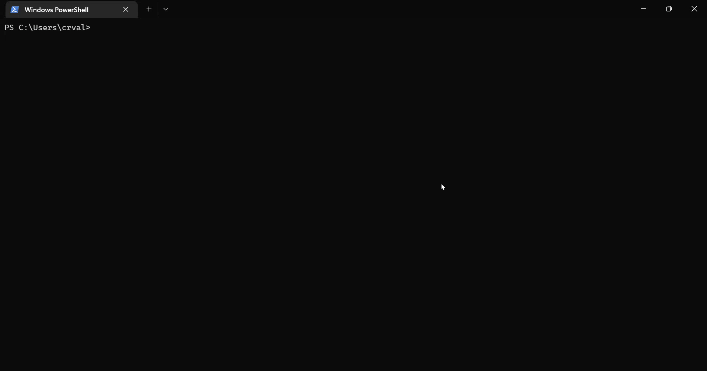

     [](https://github.com/joshschmelzle/lswifi/blob/main/CODE_OF_CONDUCT.md)


`lswifi` is a CLI-centric Wi-Fi scanning tool for Windows, macOS, and Linux that provides more information about nearby Wi-Fi networks than built-in tools (e.g. `netsh wlan show networks`). Examples include Received Signal Strength Indicator (RSSI), showing security AKMs and ciphers, decoding 802.11 IEs, revealing 6 GHz Reduced Neighbor Reports, and more. With capable Wi-Fi adapters, lswifi can detect and show networks in 2.4 GHz, 5 GHz, and 6 GHz bands.

Note: Recent versions of Windows add OFDM rates, RSSI, AKMs and ciphers, QBSS, and limited RNR information to `netsh wlan` output. `lswifi` still offers additional information, parsing, filtering, and output options.

Installation
------------

Note: The Python Scripts directory must be added to the PATH environment variable.

``` {.sourceCode .bash}
> python -m pip install lswifi
```



macOS (preview): same install, `python3 -m pip install lswifi`; the CoreWLAN and CoreLocation bindings come with it. macOS hides SSIDs, BSSIDs, and information elements unless Python has a Location Services grant. lswifi needs a code-signed Python, such as the [python.org installer](https://www.python.org/downloads/macos/); uv, Homebrew, and pyenv builds can't be granted. Enable Python in System Settings > Privacy & Security > Location Services. If the prompt never appears, use the + button to add the Python interpreter lswifi runs under and turn it on. The warning prints that interpreter's path. Without a grant, one warning on stderr names the state. `--get-interfaces` prints `Location Services:` and the state.

Linux (preview): same install, `python3 -m pip install lswifi`; no extra packages. Scanning uses nl80211, so run `sudo lswifi` to trigger a fresh scan (`CAP_NET_ADMIN`); without it, `lswifi` shows the kernel's cached results. `--supported` is not available on Linux.

Usage
-----

Output nearby Wi-Fi networks:

``` {.sourceCode .bash}
> lswifi
```

Output nearby Wi-Fi networks that have a detected signal of `-60 dBm` or stronger:

``` {.sourceCode .bash}
> lswifi -t -60
```

Output only networks that match `SegaGenesis` (partial match support):

``` {.sourceCode .bash}
> lswifi -include SegaGenesis
```

Output verbose information (including Information Elements) for BSSID `00:00:00:00:00:00` (exact match):

``` {.sourceCode .bash}
> lswifi -ies 00:00:00:00:00:00
```


Print help information:

``` {.sourceCode .bash}
> lswifi -h
```


Print and add detected AP names column in output:

``` {.sourceCode .bash}
> lswifi --ap-names
```

Print and add detected AP names and QBSS column in output (try adding --mfp or --tpc too!):

``` {.sourceCode .bash}
> lswifi --ap-names --qbss
```

Print an alternative table for BSSes which may contain 6 GHz Reduced Neighbor Reports:

``` {.sourceCode .bash}
> lswifi -rnr
```

Watch event notifications (inc. roaming, connection, scanning, etc.):

``` {.sourceCode .bash}
> lswifi --watchevents
```

Measure how strong and how steady the link you're connected to is. Keep the device and AP still, then run:

``` {.sourceCode .bash}
> lswifi --rssi-stats
```

lswifi measures the connected BSSID on the band it's connected on. It runs 30 scans 2 seconds apart, prints one line per scan instead of the scan table (`scan 7/30: -65 dBm`, or `not seen`), then prints a summary:

```
RSSI stats
  SSID       ExampleNet
  AP name    AP-12
  BSSID      00:00:5e:00:53:01
  band       6 GHz, channel 37, 80 MHz
  samples    30/30 scans
  mean       -65.2 dBm
  stdev      0.9 dB
  CV         1.4%
  min        -67 dBm
  max        -64 dBm
  spread     3 dB
  interface  00:00:5e:00:53:aa
```

`stdev` is the sample standard deviation of the dBm readings. `CV` is the coefficient of variation: stdev divided by the absolute value of the mean dBm, as a percentage. The AP name comes from the beacon, from the cache with `--ap-names`, or from your ethers file with `-ethers`. Rows with no value are left out. Use `-n` or `--time` to change the run length and `-i` to change the gap between scans. If no interface is connected, lswifi exits with an error.

To compare antennas, adapters or placements, run the same command once per setup, change one thing between runs, and compare the summaries. Add `--json` to keep each run:

``` {.sourceCode .bash}
> lswifi --rssi-stats -n 60 --json antenna-a.json
> lswifi --rssi-stats -n 60 --json antenna-b.json
```

`--json` writes the per-scan rows to `scan_data` as usual and adds an `rssi_stats` list with the summary values, including `ssid`, `ap_name`, `band`, `channel`, `channel_width` and `cv` when known. Keys with no value are left out, never set to `null`. If you stop the run with Ctrl-C, lswifi still prints the summary but doesn't add `rssi_stats` to the file. It isn't meant for a moving client or a roaming test. Movement or roaming doesn't stop the run, but it can mean fewer samples and a wider spread.

To measure a BSSID you aren't connected to, add `-bssid` with the full address:

``` {.sourceCode .bash}
> lswifi --rssi-stats -bssid 00:00:5e:00:53:01
```

`-bssid` matches link BSSIDs, not the AP MLD address. A partial address is an error in this mode. Readings are kept per interface, BSSID and band. If an AP uses the same BSSID on two bands, each band gets its own summary, and lswifi logs a warning that names the BSSID and the bands. With `--json`, each of those entries also gets `bssid_bands`, the list of bands that BSSID was seen on. Add `-a` (5 GHz), `-g` (2.4 GHz) or `-six` (6 GHz) to measure one band. Without `-bssid`, a band flag that leaves out the connected link is an error.

`--rssi-stats` bypasses the signal threshold automatically, so weak readings are kept and the spread is not skewed. Passing `-threshold` or `-t` with `--rssi-stats` is an error.

Export scan results to pcap:

``` {.sourceCode .bash}
> lswifi -export
```

PowerShell Tab Completion
-------------------------

To enable PowerShell tab completion for `lswifi`, run the following command in PowerShell:

``` {.sourceCode .powershell}
lswifi completion powershell | Out-String | Invoke-Expression
```

To make this permanent, add the above command to your PowerShell profile. To find and edit your profile:

``` {.sourceCode .powershell}
# View your profile location
$PROFILE

# Add the completion script to your profile
lswifi completion powershell | Out-String | Invoke-Expression >> $PROFILE

# Or edit manually
notepad $PROFILE
```

Then restart PowerShell or reload your profile:

``` {.sourceCode .powershell}
. $PROFILE
```

CLI options
-----------

```ascii
positional arguments:
  {completion}          commands
    completion          Generate shell completion script

CLI options
-----------

```ascii
positional arguments:
  {completion}          commands
    completion          Generate shell completion script

options:
  -h, --help            show this help message and exit
  -version, --version, -V
                        show program's version number and exit
  -n, --scans #         set how many scans to do before exiting
  --time #              set test in seconds to perform scans for
  -i, --interval #      seconds between scans
  -ies [BSSID]          print extra information about information elements for a specified BSSID
  -threshold, -t -82    threshold which excludes networks with weak signal strength from results (-82 is default)
  -all                  remove threshold filtering which excludes results with weaker signal
  -g                    display filter to limit output by 2.4 GHz band
  -a                    display filter to limit output by 5 GHz band
  -six                  display filter to limit output by 6 GHz band
  -include, -inc SSID   display filter to limit results by specified SSIDs (partial matching supported)
  -exclude, -exc SSID   display filter to exclude results by specified SSIDs (partial matching supported)
  -bssid, -bss BSSID    display filter to limit results by specified BSSIDs (partial matching supported)
  --rssi-stats          measure how strong and how steady one link is while the device and AP stay still. by default it measures the connected BSSID on the band it is connected on, runs 30 scans 2 seconds apart, prints one progress line per scan instead of the table, then prints a summary with the SSID, AP name (when known), BSSID, band, channel and width, samples, mean, stdev, CV (stdev / |mean|), min, max and spread, and adds rssi_stats to the --json file. example: lswifi --rssi-stats. -n, --time and -i override the defaults. to compare antennas, adapters or placements, run once per setup and compare the summaries, for example lswifi --rssi-stats -n 60 --json antenna-a.json. -bssid measures that BSSID instead and needs the full address; it matches link BSSIDs, not the MLD address. readings are kept per interface, BSSID and band; if one BSSID is seen on two bands, lswifi warns and gives each band its own summary. without -bssid, a band flag (-a, -g, -six) that leaves out the connected link is an error. the signal threshold is bypassed in this mode, so weak readings are kept; -threshold (-t) is rejected. movement or roaming does not stop the run but can mean fewer samples and a wider spread
  --ap-names            adds an ap name column to output and will cache ap names locally to help provide consistent results
  --qbss                adds station and utilization columns to output using information from AP beacon QBSS IE
  --tpc                 adds TPC column to output using information from AP beacon 802.11h
  --period              adds beacon period column to output using information from AP beacon
  --uptime, -uptime     sort output by access point uptime based on beacon timestamp
  -rnr, --rnr           special mode to create an alternate table based on RNR results
  --channel-width 20|40|80|160|320
                        display filter to limit output by a specified channel width
  -ethers               adds an ap name column to output and use an ethers file for the ap names
  --append-ethers BSSID,APNAME
                        append BSSID and AP name to ethers file for AP names
  --display-ethers      display the list of saved ethers; (BSSID,APNAME) mapping
  --data-location       displays where config items are stored on the local machine
  -ap                   print the BSSID of the connected AP
  -channel              print the channel, band, and frequency of the connected AP
  -raw                  format output as the raw value for other scripts (for -ap and -channel only)
  --get-interfaces      print current Wi-Fi status and information
  --list-interfaces     print a list of available WLAN interfaces
  --json [JSON]         output will be formatted as json
  --indent 4            JSON output will be formatted with pretty print with provided indent level
  --csv [CSV]           output will be formatted as csv
  -exportraw, -expraw [BSSID]
                        export raw bss and ies bytefiles. default behavior will export all from a scan. to export only one, provide full mac address of the BSSID as argument.
  -export, -exp [BSSID]
                        export scan results to pcapng file. default behavior will export all from a scan. to export only one, provide full mac address of the BSSID as argument.
  -path EXPORT_PATH     output path for -export, and directory for -exportraw (a .pcapng path uses its directory); defaults to the app data directory
  -decoderaw BYTE_FILE  decode a raw .BSS or .IES file
  -decode PCAP_FILE     parse scan results from pcap/pcapng file. by default shows all networks in the file, can be combined with filtering options.
  --bytes BSSID         output debugging bytes for a specified BSSID found in scan results.
  --watchevents         a special mode which watches for notification on a wireless interface such as connection and roaming events
  --syslog <server IP>  syslogs events from --watchevents to a remote syslog server
  --debug               increase verbosity for debugging
```
